<div align="center">

# MasjidOne

**One system for a masjid's madrasah and its congregation.**

Registers, fees and parent access on one side. Prayer times, a congregation
app, the website, the hall screens and donations on the other.
The same family, on both.

Built in Bolton, for masājid across the UK.


</div>

<br/>

> [!NOTE]
> **Reading this without a technical background?** Start at *The problem*, *The
> four surfaces* and *One evening, end to end*. Those three explain what
> MasjidOne is and what it does for a masjid. Everything after *How the pieces
> fit* is for whoever maintains the code.

### How to read the diagrams

Every picture in this file uses the same four colours, and they always mean the
same thing. The connectors animate, so you can see which way the information
actually travels.

| | Means |
| :--- | :--- |
| ⬛ **Deep green, brass border** | MasjidOne itself — our code, our database |
| 🟩 **Pale green** | Live, working, in a masjid today |
| 🟨 **Sand, dashed border** | In development — not built, not sold as built |
| ⬜ **Stone** | A person, or something outside the system |

---

## The problem, in one picture

A typical masjid runs its week across half a dozen things that have never
heard of each other. The office knows a family three separate times and
can join them up only by remembering.



Plenty of products do the congregation side, and do it well. The part
nobody else does is running the **madrasah's daily operations** — the
register marked each evening, the sabaq heard, the fee due — in the same
system, and then giving a parent a view of their own child.

---

## The four surfaces

Every masjid on MasjidOne gets the same four things. Same layout, their
colours, their domain.



> [!IMPORTANT]
> **The madrasah portal is built. Parent access is not.** The portal holds a
> masjid's roll, classes, staff and households, with registers and fees
> configured. What is still in development is *parent access* — the half a
> parent sees — and *Hifz and sabaq progress*. Those two are tagged "in
> development" here, on the website and in the console, and they stay tagged
> until they are real.
>
> This paragraph said all three were unbuilt until October 2026, which was
> wrong and had been wrong for a while. Before you change a status claim
> anywhere, **check the database** — see the warning below.

---

## One evening, end to end

The clearest way to explain the product is to follow a single Tuesday. A teacher
marks a register at six; by Wednesday morning the office knows which class
*didn't*; and the child in that register is the same record the congregation
side already holds.



> [!TIP]
> **The dashed sand box is the whole business.** Everything to the left of it is
> a madrasah system; plenty of those exist. The parent seeing their own child in
> the app they already use for prayer times is the part nobody else does — and
> it is the part still in development.

---

## How the pieces actually fit

This is the technical picture. **This repository is only the top-left box** —
the marketing website. The platform lives in its own repository.



### Why one database and not one per masjid

Every table carries a `masjid_id`. Every function and every security
policy filters on it, and a person can only ever act for one masjid at a
time.


A database each would mean a separate migration, a separate set of keys
and a separate auth setup for every customer — and the whole point of the
product, one record of one family reachable from both sides, happens
*inside* a masjid rather than between them. Separation buys nothing there
and costs a great deal to run.

**This is finished for the functions rather than planned.** Every function that
reads a masjid now has a way to be told which one, and the last two learned on
2 October 2026. It was tested by inserting a second masjid and running the whole
public surface against both, inside a transaction that always rolls back.

> [!CAUTION]
> **Two views did not learn, and they will take the public site down on the day
> a second masjid is inserted.** `notices_live` and `hall_availability` are
> `SECURITY DEFINER` views that still filter on `masjid_id = sole_masjid()`.
> They therefore **fail closed rather than leaking**, which is the right way
> round — but "fail closed" here means the public notices board and hall
> availability start raising for the *first* masjid too, not just the second.
>
> The parameterised function forms already exist: `notices_live(p_masjid text)`
> and `hall_availability(p_masjid text)` are both there and both anonymously
> callable. Converting the callers is a change in the platform repository and in
> whichever masjid portal reads them, and it has to happen in the same commit —
> change the view alone and a masjid's notices board goes blank. **Not urgent
> today. Blocking the moment a second masjid is signed.**

> [!IMPORTANT]
> **`sole_masjid()` raises once a second masjid exists, and must keep raising.**
> It is tempting to give it a default. Do not: a signed-out visitor asking for
> "the" masjid when there are two has not said enough, and a default would
> serve one mosque's prayer times, brand or term dates to another's
> congregation. A loud exception is the correct answer, and its message already
> tells the caller to pass a slug.

The rule that falls out of it, and the one that is easy to get backwards:
**anonymous reads name the masjid; signed-in reads ask the session.** A public
page passes a slug because nobody is signed in. A staff screen resolves
`current_masjid()`, because the right answer is whichever masjid that person is
standing in — which, for MasjidOne support, is not the one their build was
compiled for.

### Changing that database, and the one thing that will waste your afternoon

The schema lives in the platform repository, not this one. Two notes belong here
anyway, because this is where somebody goes looking.

> [!IMPORTANT]
> **`DROP` and `DELETE` hang through the Supabase MCP tooling. They are not
> broken.** Both wait on an interactive confirmation for destructive statements
> that the tooling cannot deliver outside a dashboard, so they sit until the
> call times out and the whole transaction rolls back — leaving no trace, which
> is what makes it look like a database fault. `ALTER`, `UPDATE`, `INSERT`,
> `REVOKE` and `CREATE FUNCTION` all go through normally. **Run anything
> destructive in the Supabase SQL editor.**
>
> This is the explanation for the `masjid_theme(text)` entry that has sat in
> `CLAUDE.md` since 2 October saying the drop "timed out repeatedly while every
> other statement went through". Nothing was wrong with the database.
>
> A corollary worth keeping: to change a policy, prefer **`ALTER POLICY`** over
> `DROP` plus `CREATE`. It avoids the timeout, and it is better practice anyway
> — there is no window in which the policy does not exist.

Three pieces of hardening were applied in October 2026 and are recorded here so
nobody reads them as accidental:

| Change | Why |
| :--- | :--- |
| `bmcc` uploads capped at 10 an hour, bucket-wide | Anonymous upload is **deliberate** — `charity_collections.bmcc_certificate_path` stores the path, so the file must exist before the record and the submitter is not signed in. The defect was that this was the only anonymous write with no rate limit, while all eight anonymous intake tables carry a rate-limit trigger — five on `rate_limit_by_contact` at 3–5 a day per phone or email, three on their own function. Storage carries no identity for an anonymous uploader, so a bucket-wide ceiling is the only thing available at the policy layer |
| `brand` bucket capped at 5 MB, images only | It is a **public** bucket and had no size or type limit. SVG is excluded on purpose: it is a script-bearing document, and a public URL serving one is an executable file |
| `admin_audit` INSERT now requires `verified_admin()` | It previously accepted any signed-in session, so a teacher or parent could append rows. Append-only is still achieved the same way — by having **no** UPDATE or DELETE policy — and every `SECURITY DEFINER` function that writes audit rows is unaffected, because they run as `postgres`, which owns the table and `relforcerowsecurity` is false |

---

## The stack, in four layers

Left to right: what gets written, what it compiles to, where that runs, and the
two outside services it talks to.



| Layer | What and why |
| :--- | :--- |
| **TypeScript 5.7** | Every file. A mosque's fee ledger is not a place for `undefined` |
| **Next.js 15** · React 18.3 | App Router, static export — no server at request time |
| **Tailwind 3.4** + shadcn/ui | Driven by MasjidOne's own tokens, not Tailwind's defaults |
| **Postgres 17** on Supabase | One database. Every table carries `masjid_id` |
| **Row Level Security** | The database refuses the wrong rows; it is not an `if` statement in the app |
| **Deno edge functions** | Notifications and webhooks |
| **React Native · Expo** | The congregation app, iOS and Android |
| **Stripe** | The masjid's own account. We never touch the money |
| **OneSignal** | Push, scoped per masjid |
| **GitHub Actions → Pages** | Builds and publishes. Nothing to patch at 2am |

> [!IMPORTANT]
> **`output: 'export'` is a constraint, not a preference.** The marketing site
> compiles to plain files on a CDN. Adding anything that needs a Node server at
> request time breaks the deploy — and removes the main reason this site cannot
> go down.

---

## This repository

The marketing site. Its job is to give a masjid committee somewhere to
land after a conversation, look at what they would be buying, and ask for
a demo. It is not a self-serve signup — nobody buys this without a
meeting.

```bash
npm install
npm run dev     # http://localhost:3000
npm run build   # static export to out/
```

**Next.js 15 (App Router) · TypeScript · Tailwind · shadcn/ui.**
`output: 'export'` writes plain HTML, CSS and JS to `out/`, so there is
nothing to run at request time and nothing to keep patched.

> [!NOTE]
> **Contact details are live.** `CONTACT_EMAIL` is `info@masjidone.co.uk`,
> `SUPPORT_EMAIL` is `support@masjidone.co.uk` and `PRIVACY_EMAIL` is
> `privacy@masjidone.co.uk` — the legal pages name their own address so that
> routing a subject access request elsewhere happens at the mail host and no
> page changes. `CONTACT_PHONE` is set, so the telephone line renders; emptying
> it hides the line rather than printing a placeholder.

### Deploying

GitHub Actions builds and publishes to Pages
(`.github/workflows/deploy.yml`). Pages cannot build a Next app from a
branch, so **Settings → Pages → Source** must be **GitHub Actions**.

> [!CAUTION]
> **`public/CNAME` decides the URLs.** If it holds a domain, the base path is
> empty and the canonical origin is that domain — `next.config.mjs` reads the
> file and ignores a stale `NEXT_PUBLIC_BASE_PATH` rather than obeying it. This
> is not a preference: the live site once shipped with **every asset 404ing**
> because the variable still said `/MasjidOne` while the custom domain served
> from the root.

| Variable | When you need it | Value |
| --- | --- | --- |
| `NEXT_PUBLIC_BASE_PATH` | Only with **no** `public/CNAME`, served from `<user>.github.io/MasjidOne` | `/MasjidOne` |
| `NEXT_PUBLIC_SITE_URL` | Only with **no** `public/CNAME` | the full origin |
| `NEXT_PUBLIC_COMMIT_DATE` | Set by the workflow | the last commit date, for `sitemap.xml` |
| `NEXT_PUBLIC_FORM_ENDPOINT` | To make the demo request form post rather than open a mail client | `https://masjidone-forms.<your-subdomain>.workers.dev/demo-request` |
| `NEXT_PUBLIC_BILLING_ENDPOINT` | To enable Direct Debit in the support console | the deployed `masjidone-billing` function URL, no trailing slash |
| `GOOGLE_SITE_VERIFICATION` | Only for a Search Console **URL-prefix** property | the token |

A Search Console *Domain* property is verified by DNS at the registrar and
needs none of this.

### Browser hardening, and what Pages cannot send

The Content Security Policy is a `<meta>` tag, built by
`lib/security-policy.ts` from the same constants the running code uses — so
adding a masjid to `MASJID_SCREENS` extends `frame-src` on the next build, and
setting `NEXT_PUBLIC_FORM_ENDPOINT` adds that origin to `connect-src` and
`form-action` without anybody remembering to. Same reasoning as
`next.config.mjs` reading `public/CNAME`: a value written in two places is a
value that will eventually disagree with itself.

It is a meta tag because **GitHub Pages cannot set response headers.** That is
measured, not assumed: `curl -I https://masjidone.co.uk/` comes back with the
ordinary content and caching headers and **not one security header** among them
— no HSTS, no `X-Frame-Options`, no `X-Content-Type-Options`. So three controls
are not merely missing, they are **unavailable on this host**:

| Control | Status here |
| :--- | :--- |
| `Strict-Transport-Security` | No meta equivalent exists. Absent |
| `X-Frame-Options` | No meta equivalent exists. Absent |
| `frame-ancestors` | Legal in a CSP but **ignored in meta form**. Absent |

> [!IMPORTANT]
> **This policy does not stop cross-site scripting, and must not be described as
> if it does.** `script-src` carries `'unsafe-inline'` because Next emits inline
> bootstrap and hydration scripts, and the alternatives both need something a
> static export has not got: a nonce needs a server to mint one per request, and
> hashes change on every build. What it genuinely refuses is narrower and still
> worth having — script from an origin that is not ours, `<base href>`
> hijacking, a form posted somewhere unnominated, `<object>` content, and
> connections to an origin not on the list.
>
> **Clickjacking is therefore open**, and closing it means serving `/admin/`
> from somewhere that can send real headers. It is an open item, not a solved
> one.

> [!CAUTION]
> **`form-action` lists `mailto:` and the Worker origin on purpose.** Both forms
> carry a real `action` and `method="POST"` so they work with JavaScript
> disabled — see the top of `components/demo-request-form.tsx`. A tidy-looking
> `form-action 'self'` breaks that fallback, and breaks it **invisibly**: the
> failure appears only with JavaScript off, which is exactly the visitor the
> fallback exists for.

**A CSP is verified in a browser or not at all.** Too strict a policy throws
nothing at build time; it silently refuses a stylesheet or a `fetch` at runtime,
which is how a CSP ends up worse than none. The check that matters is loading
every route with the console open — including a sign-in attempt, because
`/admin/` makes no network call until you try one, so `connect-src` is otherwise
never exercised.

Two more things in the same pass, both small:

- **`jsonLd()` in `lib/utils.ts` replaces `JSON.stringify` for the
  `application/ld+json` blocks.** `JSON.stringify` escapes quotes and
  backslashes and leaves `<` and `/` alone, so a value containing `</script>`
  closes the element and everything after it parses as markup. Nothing
  injectable reaches those blocks today — which is the reason to fix it now,
  because structured data is exactly the thing that gets wired to a masjid's
  own name later.
- **The framed masjid screen in the support console is sandboxed.** Being
  cross-origin it never could read the console's DOM or storage; what it could
  do was navigate the whole console elsewhere. `allow-scripts` with
  `allow-same-origin` is safe here precisely because the frame is always a
  masjid's *separate* domain — that pairing is only a foot-gun when a page
  frames its own origin and the frame can reach up and drop its own sandbox.

### The billing function answers a preflight

`supabase/functions/masjidone-billing` has two routes and they are treated
differently on purpose.

`/start` is called from a browser — `components/admin-direct-debit.tsx` posts
cross-origin from `masjidone.co.uk` with `Authorization` and
`Content-Type: application/json`. Both of those make the request non-simple, so
the browser sends a preflight `OPTIONS` and refuses to send the real `POST`
unless it is answered. The function previously returned `405` to every non-`POST`
and no `Access-Control-Allow-Origin` at all, so **the button could not have
worked from a browser** — and it would have failed first in front of a
committee, because `/start` is reachable only from the Direct Debit panel.
Origins are named, never `*`; a wildcard is not even legal on a request that
carries `Authorization`.

`/webhook` deliberately gets none of it. Stripe is not a browser, sends no
`Origin`, and is not subject to the same-origin policy. Advertising the function
to web pages on the route that accepts signed events would widen it for nothing.

> [!NOTE]
> **CORS is not the authorisation.** `/start` is protected by `readAsCaller()`,
> which builds a client as the caller and asks the database a question only a
> two-step platform admin may ask — so the check and the data it needs are the
> same call, and there is no way to get the data without passing the check.

### Where the demo request form posts

`worker/` holds a Cloudflare Worker that takes a demo request and hands it to
**Resend's REST API**, which sends the email. **Written and tested, not yet
deployed** — `worker/README.md` has the steps. Until `NEXT_PUBLIC_FORM_ENDPOINT`
is set the form hands its answers to the visitor's own mail client instead.

The alternative was a form company like Formspree: twenty minutes of work, and
a business that then holds every enquiry a committee ever sends, in their
dashboard, under their retention policy.

> [!NOTE]
> **It used to use Cloudflare Email, and cannot.** Cloudflare's own
> documentation requires the zone to be on Cloudflare DNS for Email Service,
> and `masjidone.co.uk` is entirely on One.com — which also supplies automatic
> DKIM that a migration would cost. Outbound Email Sending also reads "Not
> available" on the Workers free plan, and Email Routing replaces the root MX,
> which would stop the mailboxes receiving. Hence Resend, and hence
> `workers_dev = true`: the custom route needed a zone Cloudflare does not hold.

**Resend verifies `send.masjidone.co.uk`, not the root, and that is the point.**
Its SPF, DKIM and bounce records live on the subdomain, where they cannot
collide with the root SPF or disturb the MX the mailboxes depend on. If a screen
offers to change the root MX or the root SPF, it is the wrong screen.

> [!IMPORTANT]
> **Two processors, not one, and one of them keeps a copy.** Cloudflare carries
> the submission and Resend sends it; both are processors and the privacy notice
> names both. Resend also **retains the message for thirty days** on every plan,
> including the free one. "Resend only transmits" is wrong and must not be
> written. `app/privacy/page.tsx` reads `FORM_ENDPOINT` and prints the mailto
> wording or the Worker wording to match — do not replace that conditional with
> whichever branch happens to be true today.

The Worker checks `response.ok`, not merely whether `fetch` threw. A 401 from a
rolled key arrives as a perfectly happy `Response`, and an unchecked call would
tell every visitor their enquiry was sent while nothing was.

**The API key is a credential.** It goes in `wrangler secret put RESEND_API_KEY`
and nowhere else — not in `worker/wrangler.toml`, not in a commit. This repository is
public and git history is permanent.

Defences, since there is deliberately no captcha: a honeypot answered `200` so
a bot does not retry, five posts a minute per IP, a 32 KB ceiling, per-field
caps, an origin check, and the enquirer's address in `Reply-To` rather than
`From`.

### What the site is

Nine indexable pages, plus two things that are deliberately not indexed: the
demonstration tenant, and the live support console we sign into ourselves.

| Route | What it is |
| --- | --- |
| `/` | The argument: the join, the modules, the previews, the prices |
| `/madrasah-software/` | Registers, fees, families |
| `/mosque-prayer-times-screens/` | One timetable, every screen |
| `/mosque-app/` | Times, reminders, notices, giving |
| `/mosque-website/` | The managed website |
| `/mosque-donations/` | 0% commission and Gift Aid |
| `/request-a-demo/` | The form, on its own page, where all eight CTAs point |
| `/privacy/`, `/terms/` | Legal |
| `/demo/` | The demonstration tenant — `noindex`, disallowed in `robots.txt` |
| `/admin/` | **The live support console.** Real sign-in, real masajid — `noindex`, disallowed, absent from the sitemap |

The five module pages exist because one URL cannot rank for more than one
intent. Each declares **its own** canonical and `openGraph.url`: the root
layout deliberately sets neither, because a default there is inherited, and
`/privacy/` once told Google it was a duplicate of the home page. Next does not
derive `og:url` from a canonical, and it *replaces* `openGraph` rather than
merging it — so every page builds its whole block from `openGraphFor()` in
`lib/site.ts` or it silently loses the card image.

### The demonstration tenant

`/demo/` is a sales walkthrough built from invented data in `lib/demo-data.ts`.
There is no database behind it and the sign-in is a string comparison in the
browser, which is why the credentials are printed on the screen — a login box
on a public URL that appears to guard something real, but does not, is a
credential-harvesting shape.

```
/demo/                          sign in with demo / demo
/demo/?masjid=Masjid+e+Taqwa    the committee sees their own name
/demo/#office                   open straight on a screen, mid-call
/demo/teacher/                  a teacher: their classes, their register
/demo/parent/                   a parent: their own children, nothing else
/demo/app/                      the congregation app, opening signed out
/demo/support/                  our console, as a committee would be shown it
/demo/ticket/                   "Having issues? Log a ticket"
```

The doors are deliberately separate. A parent is not a smaller administrator —
they arrive to answer one question, and should never see a screen implying the
rest of the madrasah is theirs to look at.

Navigation is the URL, not component state. Each screen has a hash and the
stage is derived from it, so the browser's back button — and the phone's back
gesture, which matters more — work. An earlier attempt used `history.state`;
Next's App Router owns `popstate` and remounts the page, which made one Back
jump three screens.

The scale is deliberately **not** the real customer's, so a screenshot of the
demo can never be mistaken for their data. Imagery rules live in
`public/devices/README.md`: nothing in that folder is a screenshot, and no real
child's record or family's fee history is ever published.

### The live support console

`/admin/` is the one page in this repository that touches the real platform.
Everything else is marketing copy or a demonstration built from fixtures. Sign
in with a real platform account, see the masajid MasjidOne supports, switch
into one.

It needed nothing new in the database. `my_masjids()` and
`set_current_masjid()` have existed since the multi-masjid work and had
**zero callers** — the first already returns every masjid to a platform admin,
each flagged with whether you are inside it and whether entering counts as
support access. This is a window onto functions that were already there.

**Every gate is in Postgres, not in the page.** Someone who edits the
JavaScript in their browser gets nothing:

| Layer | What it does |
| :--- | :--- |
| `anon` holds no `EXECUTE` | Refused at the grant, before the function body runs |
| `my_masjids()` | Returns nothing without `auth.uid()`, everything only to a platform admin |
| `is_platform_admin()` | Requires `is_aal2()` — a completed second factor, so the console has a real authenticator step |
| `set_current_masjid()` | Refuses a masjid you neither belong to nor administer, and writes `masjidone_support_access` into **their** audit trail when it is the latter |

> [!CAUTION]
> **"`anon` holds no `EXECUTE`" is worth checking rather than assuming, because
> Postgres grants `EXECUTE` to `PUBLIC` by default and `anon` inherits it.**
> `masjid_attention()` — which returns a masjid's whole operational picture,
> pupil, staff, concern and payment counts — was anonymously callable for
> exactly that reason. It always refused on its first statement, so nothing
> leaked, but it had no business being on the anonymous surface.
>
> The trap is that **`REVOKE EXECUTE ... FROM anon` is a silent no-op** when the
> grant is to `PUBLIC`: it reports success and changes nothing. It has to be
> `FROM PUBLIC`, and then any role that needs it wants an explicit grant.
> `has_function_privilege('anon', …)` is the only answer worth believing — read
> `proacl` and a bare `=X/postgres` entry is the `PUBLIC` grant.

> [!IMPORTANT]
> **Entering a masjid you hold a role at is not support access and is not
> logged.** The audit row is written only when you are platform staff *and not*
> a member. The console says which case it is on the card, rather than implying
> a trail that is not being written.

> [!NOTE]
> **There is a second sign-in at the end, and it is not an oversight.** The
> console is served from `masjidone.co.uk`; a masjid's portal is served from
> its own domain, and a Supabase session lives in storage scoped to one origin,
> so it cannot follow you. Entering still does the real work —
> `set_current_masjid()` is server-side state, so you arrive pointed at the
> right masjid. Carrying the session across would mean putting tokens in a URL
> and re-enabling `detectSessionInUrl` on a portal that deliberately set it to
> `false`.

`/demo/support/` is the same screen built from fixtures. The two are
deliberately the same shape: a committee shown the demo is being shown what we
actually use, and if they drift apart the demo becomes a lie. **Change one,
look at the other.**

### Where things live

| What you want to change | File |
| --- | --- |
| The prices | `lib/site.ts` — `PRICING_BANDS` is the only source; `BAND_RANGE` and the yearly total (`price * 12`) are derived, so neither can drift into a discount |
| Plan features and copy | `components/masjidone-pricing.tsx` |
| The pricing block itself | `components/ui/pricing.tsx` |
| Every other home page section | `components/site-sections.tsx` |
| Behaviour for those sections | `components/site-behaviour.tsx` |
| A module page's content | `app/<slug>/page.tsx` — data only |
| The module page layout | `components/module-page.tsx` |
| The demo's screens | `components/demo-*.tsx` |
| The demo's data | `lib/demo-data.ts` |
| The live support console | `components/admin-console.tsx` |
| Which platform it talks to | `lib/platform.ts` — and where each masjid's portal lives |
| The demo request form's endpoint | `worker/` — see `worker/README.md` |
| Direct Debit and the Stripe webhook | `supabase/functions/masjidone-billing/` |
| What Google reads | `components/structured-data.tsx` |
| The Content Security Policy | `lib/security-policy.ts` — derived from the constants above it, never typed twice |
| Escaping for the JSON-LD blocks | `lib/utils.ts` — `jsonLd()`, because `JSON.stringify` does not escape `</script>` |
| Canonical URL, contact address | `lib/site.ts` |
| Colour, type and spacing | `app/globals.css` |
| The full design system | `DESIGN.md` |
| The rules that are not wording choices | `CLAUDE.md` |

---

## When something goes wrong

Most things a masjid wants changed are not faults at all — they are the masjid's
own content, and the masjid changes them itself without asking anybody. The
small remainder comes to us, and a fix reaches every masjid rather than only the
one that reported it.


### Who fixes what

| It is… | Who | How long |
| :--- | :--- | :--- |
| A wrong jamāʿah time, a notice, a fee rate, who has access | **The masjid**, in the portal | Immediately |
| A pupil in the wrong class, a family to merge | **The masjid**, in the portal | Immediately |
| A screen showing the wrong thing, a button that does nothing | **MasjidOne** | Reproduced against your own configuration |
| Anything touching a child's record or money | **MasjidOne**, treated as urgent | Ahead of everything else |

> [!IMPORTANT]
> **A masjid never waits on us for its own content.** If the office has to open a
> ticket to change Maghrib, the product has failed. Everything a committee
> routinely needs to change is theirs to change, which is also why role-based
> access matters: the person who should change it can, and nobody else can.

> [!NOTE]
> **The support route is live.** Enquiries reach `info@masjidone.co.uk` and
> customer support reaches `support@masjidone.co.uk` — deliberately two
> addresses, because the person answering a sales question and the person
> answering a broken register are on different clocks.
>
> The *"Having issues? Log a ticket"* link does not use either: it opens
> `/demo/ticket/`. It previously pointed at a `mailto:` aimed at a placeholder,
> which meant the one control on the demo intended for a committee that is
> stuck opened an empty mail window addressed to nowhere.

There is no overseas support desk and no outsourced queue. A masjid talks to
the **MasjidOne support team** — the people who wrote the system and can fix it.

---

## What it costs

**Pricing is banded by the size of the madrasah** — four bands by pupil count,
across two plans (**Madrasah**, and **Masjid Complete** which adds the website,
the app, the screens and donations). Setup is **£499 once**, waived on twelve
months prepaid, and donations carry **0% commission**.

> [!IMPORTANT]
> **The per-band figures are deliberately not repeated here.** They live in
> `PRICING_BANDS` in `lib/site.ts` and nowhere else; `BAND_RANGE` derives the
> ranges from them, and `components/structured-data.tsx` derives what Google
> reads from the same source.
>
> This README printed `£79` and `£179` until 8 October 2026 — the flat rates
> abandoned on 4 October, one of which was never a price in the new table at
> all. A figure copied into prose cannot be type-checked and will rot. If you
> are tempted to paste the numbers back in for convenience, that is the bug
> this note exists to prevent.

Yearly billing is the same rate shown twelve times over, not a discount. Only
the setup fee falls. A band is **not** per-pupil pricing: the figure changes
only at renewal, and only on crossing a threshold.

---

## Before you change any copy

> [!CAUTION]
> Read **`CLAUDE.md`** first. The prices, the competitive claim and the
> "in development" tags are **commercial commitments, not wording choices**. A
> wrong one loses a sale and the referral behind it.

Three that catch people out:

- **Never claim a feature that is not built, and never deny one that is.**
  This README broke that rule itself until 2 October 2026: it said parent
  access and Hifz/sabaq progress were in development. **Both are built**, and
  have been — 16 parent functions and six progress functions, all enforcing.
  They were tagged across eleven places on the site because their tables were
  empty, and *zero rows means nobody has used it yet, not that it does not
  exist*. Months of telling committees a shipped feature was coming.
  Today **one thing carries the tag: the screen heartbeat**, and it is in the
  demo rather than on the public site — there is no screens table in the
  platform and no function takes a screen id. Nothing else is tagged.
  The test is whether the *functions* exist and enforce, never whether rows
  do, so **query the database rather than trusting either document**,
  including this one.
- **Never say no competitor does the whole masjid.** Several do the
  congregation side. The defensible claim is narrower and it is written
  down in `CLAUDE.md`.
- **Compliance is a commitment, not a fact.** ICO registration and the
  data processing agreement are promised *before a masjid is invoiced*.
  Do not rewrite them into the present tense until they are done.

British English throughout, and Arabic terms keep their diacritics:
jamāʿah, Jumuʿah, janāzah, Hifz, sadaqah, madrasah, masjid. ("nikah" is
written plain throughout, in all thirteen places it appears — this list used to
say otherwise and the code never did.)

---

## The diagrams

Seven SVGs, and the connectors animate — the same travelling-beam idea the site
uses on its modules diagram. GitHub renders mermaid but cannot animate it, so
these are built rather than inlined.

The sources stay in the repo as text, so a diagram is still something you can
edit and diff rather than a picture nobody can change:

```bash
assets/diagrams/*.mmd          # the source, one file per diagram
node scripts/build-diagrams.mjs # regenerates the SVGs
```

The build script holds the palette and the animation in one place. It declares
the colours light-first and redefines them under `prefers-color-scheme`, so the
diagrams follow GitHub's theme, and it keeps a `prefers-reduced-motion` guard —
anybody who has asked their machine for less movement gets a still picture.

> [!NOTE]
> **Do not add a `font-family` override to that stylesheet.** Mermaid measures
> every label and sizes each box *before* the stylesheet is appended, so
> changing the face afterwards reflows text inside boxes built for a different
> font and silently clips the last line. It went unnoticed until a diagram had
> narrow nodes. Mermaid embeds the face it measured with — leave it alone.

Rendering needs a Chromium. If the machine has one already:

```bash
PUPPETEER_EXECUTABLE_PATH=/path/to/chrome node scripts/build-diagrams.mjs
```

---

## Licence

All rights reserved. Not open source.
